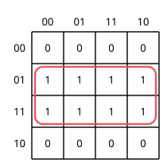

# 2026-10-10作业

## 1. 依赖

**题目要求**：第 1 题三件事一起交——**化简 + 状态表 + 逻辑电路图**；第 2 题用**卡诺图**化简。两题题面都无图（电路图要自己画）。

| 题组 | 做之前先过掉（点击直达） | 到那里你该已经会了 | 该题组用到的符号 |
| :--- | :--- | :--- | :--- |
| 7.9(2)、7.9(3)（公式法化简） | [逻辑代数与公式法化简](../课堂笔记/10-10-逻辑代数与公式法化简.md) | 基本定律五组（**互补律** $X+\overline{X}=1$、**重叠律** $X\cdot X=X$、**分配律**）；公式法**四种手段**（并项、吸收、消去、配项） | — |
| 7.9(1) 化简 + 三小问的状态表、逻辑图 | [卡诺图化简法与无关项](../课堂笔记/10-12-卡诺图化简法与无关项.md) | 卡诺图排列（循环码）、相邻关系、画圈四原则、从圈读与项；把 $A,B,C$ 各组合代进原式填状态表 | — |
| 7.10 四小问（卡诺图化简） | [卡诺图化简法与无关项](../课堂笔记/10-12-卡诺图化简法与无关项.md) | 四变量卡诺图（行、列各两个变量，都按 00/01/11/10）、画圈四原则、从圈读与项 | — |

> **怎么用这份作业**：每题拆成「提示 → 完整解答 → 复盘」三层，**默认全部收起**——先自己动笔，卡住了再逐层展开。
> **本题型三件事的套路**：① **化简**——先看式子结构：有相同因子就用并项法提公因子，见「变量 × 含该变量的和」就用吸收律收掉，含反变量与项（$X+\overline{X}Y$）就用消去法，括号乘积先展开成最小项之和再用 $X\overline{X}=0$ 清理；都不顺手再填卡诺图圈组。② **状态表**——把 $A,B,C$ 的 8 种组合逐个代入原式填 $Y$。③ **逻辑图**——用与门/或门/非门把最简式画出来。

---

## 一、习题 7.9(1)（含嵌套取反，化简到一项）

化简 $Y = \overline{\overline{AC + \overline{A}BC} + \overline{B}C + AB\overline{C}}$，并列出状态表、画出逻辑电路图。

:::collapse accordion
- 提示
  这个式子有两层横线，逐层算、别心算整式
  ① **最外层一条长横线**盖住整个括号内三项之和；**内层 $AC+\overline{A}BC$ 上还有一条**，只盖这一项。
  ② 列状态表时**把每一层单独写成列**：先算内层和 → 再算内层取反 → 再算三项之或 → 最后取反。
  ③ 状态表算完，把 $Y=1$ 的行挑出来（本题只有 011 与 111 两行）；两行里 $A$ 一个取 0 一个取 1，$B$、$C$ 都取 1——相同的变量留下（$BC$）、相异的变量消掉（$A$），即得最简式。
- 完整解答
  **列状态表**（计算顺序：内层和 → 内层取反 → 三项之或 → 最外层取反）

  | A | B | C | $\overline{A}BC$ | $AC$ | 内层和 | 内层取反 | $\overline{B}C$ | $AB\overline{C}$ | 三项之或 | $Y$ |
  | :-: | :-: | :-: | :-: | :-: | :-: | :-: | :-: | :-: | :-: | :-: |
  | 0 | 0 | 0 | 0 | 0 | 0 | 1 | 0 | 0 | 1 | 0 |
  | 1 | 0 | 0 | 0 | 0 | 0 | 1 | 0 | 0 | 1 | 0 |
  | 0 | 1 | 0 | 0 | 0 | 0 | 1 | 0 | 0 | 1 | 0 |
  | 1 | 1 | 0 | 0 | 0 | 0 | 1 | 0 | 1 | 1 | 0 |
  | 0 | 0 | 1 | 0 | 0 | 0 | 1 | 1 | 0 | 1 | 0 |
  | 1 | 0 | 1 | 0 | 1 | 1 | 0 | 1 | 0 | 1 | 0 |
  | 0 | 1 | 1 | 1 | 0 | 1 | 0 | 0 | 0 | 0 | **1** |
  | 1 | 1 | 1 | 0 | 1 | 1 | 0 | 0 | 0 | 0 | **1** |

  **读表**：$Y=1$ 只有两行——$011$（$A{=}0,B{=}1,C{=}1$）与 $111$（$A{=}1,B{=}1,C{=}1$）。这两行里 **$B$、$C$ 都取 1（相同，留下），$A$ 一个取 0 一个取 1（相异，消掉）**，两行并成一项，即 **$BC$**（也就是「$B=1$ 且 $C=1$」）。

  **画卡诺图圈组**（行 $A$，列 $BC$ 按循环码 00、01、11、10）：

  | A \ BC | 00 | 01 | 11 | 10 |
  | :-: | :-: | :-: | :-: | :-: |
  | 0 | 0 | 0 | **1** | 0 |
  | 1 | 0 | 0 | **1** | 0 |

  两个 1 落在同一列 $BC=11$，圈成一项，消去 $A$，得 **$Y = BC$**。

  **答案**：最简式 $Y = BC$。

  **逻辑电路图**（本课约定：与门方框写 **AND**、或门写 **≥1**、非门是方框内写 **1** 且输出端加小圆圈）：

---

## 二、习题 7.9(2)（吸收律：三项归一项）

化简 $Y = A(A+B+C) + B(A+B+C) + C(A+B+C)$，并列出状态表、画出逻辑电路图。

:::collapse accordion
- 提示
  每一项都长成「变量 × 含该变量的和」
  ① 三项的括号都是同一个 $(A+B+C)$，别看成一整块去提公因子——**逐项分开看**。
  ② 每项都是 $A\cdot(A+B+C)$ 这种「**变量 × 含该变量的和**」形状，正好是吸收律 $X(X+Y)=X$ 的样子，逐项收掉。
- 完整解答
  **第一步：逐项用吸收律收掉**

  三项分别是 $A\cdot(A+B+C)$、$B\cdot(A+B+C)$、$C\cdot(A+B+C)$，都形如「**变量 × 含该变量的和**」。

  按**吸收律** $X(X+Y)=X$（取 $X=A$、$Y=B+C$）：

  $$A(A+B+C)=A,\qquad B(A+B+C)=B,\qquad C(A+B+C)=C.$$

  （三项的括号都是同一个 $(A+B+C)$，各自的系数又都出现在括号里，所以每一项都被自己的系数吸收。）

  **第二步：三项相加**

  $$Y = A + B + C.$$

  **状态表**（把 $A,B,C$ 的 8 种组合逐个代入 $A+B+C$ 填 $Y$）

  | A | B | C | Y |
  | :-: | :-: | :-: | :-: |
  | 0 | 0 | 0 | 0 |
  | 0 | 0 | 1 | 1 |
  | 0 | 1 | 0 | 1 |
  | 0 | 1 | 1 | 1 |
  | 1 | 0 | 0 | 1 |
  | 1 | 0 | 1 | 1 |
  | 1 | 1 | 0 | 1 |
  | 1 | 1 | 1 | 1 |

  （只有 $A=B=C=0$ 时 $Y=0$，其余全 1——这正是"或"的定义。）

  **答案**：最简式 $Y = A + B + C$。

  **逻辑电路图**（三输入或门）：

  

---

## 三、习题 7.9(3)（展开后逐项清理，化简到一项）

化简 $Y = (A+B)(\overline{A}+\overline{B})\overline{B}$，并列出状态表、画出逻辑电路图。

:::collapse accordion
- 提示
  先展开、再用 $X\overline{X}=0$ 清理
  ① 把前两个括号相乘展开（分配律）——得到四项，其中 $A\overline{A}$ 与 $B\overline{B}$ 用互补律直接划掉。
  ② 剩下的两项乘上最后那个 $\overline{B}$，再清理一次：$\overline{B}\,\overline{B}$ 用重叠律留成 $\overline{B}$，$B\overline{B}$ 用互补律归零。
  ③ 算完可用状态表复核：式末乘了 $\overline{B}$，所以 $B=1$ 的两行 $Y$ 必为 0；状态表里只有 $B=0$ 的取值可能为 1，与结果相符即通过。
- 完整解答
  **第一步：展开前两个括号**（分配律 $(X+Y)(Z+W)=XZ+XW+YZ+YW$）

  $$(A+B)(\overline{A}+\overline{B}) = A\overline{A} + A\overline{B} + B\overline{A} + B\overline{B}.$$

  **第二步：逐项清理**（互补律 $X\overline{X}=0$）

  $$= 0 + A\overline{B} + \overline{A}B + 0 = A\overline{B} + \overline{A}B.$$

  （这是**异或** $A\oplus B$。）

  **第三步：乘上 $\overline{B}$ 并再清理**

  $$Y = (A\overline{B} + \overline{A}B)\overline{B} = A\overline{B}\,\overline{B} + \overline{A}B\overline{B}.$$

  用**重叠律** $X\cdot X=X$ 得 $A\overline{B}\,\overline{B}=A\overline{B}$；用**互补律** $B\overline{B}=0$ 得 $\overline{A}B\overline{B}=0$。所以

  $$Y = A\overline{B} + 0 = A\overline{B}.$$

  **答案**：最简式 $Y = A\overline{B}$。

  **状态表**（$A,B$ 的 4 种组合逐个代入原式填 $Y$）

  | A | B | Y |
  | :-: | :-: | :-: |
  | 0 | 0 | 0 |
  | 0 | 1 | 0 |
  | 1 | 0 | **1** |
  | 1 | 1 | 0 |

  （只有 $A=1,B=0$ 时 $Y=1$。）

  **逻辑电路图**（$B$ 经非门得 $\overline{B}$，再与 $A$ 一起进与门）：

  

---

## 四、习题 7.10（用卡诺图化简，4 小问）

用卡诺图化简下列各式为最简与或表达式。

:::collapse accordion
- 提示
  四变量卡诺图：行、列各两个变量，都按循环码 00、01、11、10
  ① 四变量卡诺图是 **4×4** 十六格；**行、列都用循环码**（00、01、11、10），不是二进制递增。
  ② 先把每式填 1，再按四条原则圈（2 的幂、只圈相邻、圈少圈大、新圈必有新 1）。
  ③ 每圈**留相同变量、消相异变量**写成一个与项，各圈用或号连。
- 完整解答
  四张卡诺图（行 $AB$、列 $CD$，都按 00、01、11、10）：

  **(1) $Y = AB + \overline{A}BC + \overline{A}B\overline{C}$**

  | AB \ CD | 00 | 01 | 11 | 10 |
  | :-: | :-: | :-: | :-: | :-: |
  | **00** | 0 | 0 | 0 | 0 |
  | **01** | 1 | 1 | 1 | 1 |
  | **11** | 1 | 1 | 1 | 1 |
  | **10** | 0 | 0 | 0 | 0 |

  第 01、11 两行**全 1**，合成一个 8 格大圈（行变量 $B=1$，列变量任意）→ **$Y = B$**。

  **卡诺图圈组**（红框＝唯一一圈，8 格）：

  

## 小结：这份作业要带走的东西

1. **两条路，看式子结构选**：① **公式法**——式子有公因子/反变量与项/括号乘积时最快（并项、吸收、消去、展开清理）；
   ② **卡诺图**——式子已化成最小项、或公式法看不出规律时，填图圈组最稳。
   ③ **逐行代入状态表**最慢，嵌套取反时极易错，只适合做校验（本题 7.9(1) 的状态表就把各层单独列成列）。
2. **吸收律是"一步杀"**：$A(A+B+C)=A$、$A+AB=A$——凡"变量 × 含该变量的和"或"变量 + 含该变量的积"，直接吸收（7.9(2) 三顶归一项就靠它）。
3. **$X\overline{X}=0$ 清理法**：把式子展开成最小项之和，凡出现"同一变量正反相乘"的项直接划掉（7.9(3) 就靠这一步）。
4. **三件事一起交**：化简式、状态表、逻辑图——**状态表是化简结果的独立校验**（两者必须一致）。
5. **逻辑图符号**（本课约定）：与门写 **AND**、或门写 **≥1**、非门是带小圆圈的方框。
6. **四变量卡诺图**：行、列各两个变量都按循环码；"整行全 1"能圈 8 格大圈（消 3 个变量），"四个角"也是相邻的一圈。
