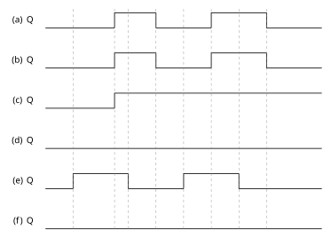

# 2026-10-26作业

## 1. 依赖

| 题 | 做之前先过掉 | 到那里你该已经会了 | 该题用到的符号 |
| :--- | :--- | :--- | :--- |
| 8.6 | [JK 状态表、特性方程与下降沿约定](../课堂笔记/10-28-触发器与时序逻辑电路.md#边沿约定与波形演算) | 由 [$J$]{#sym-J}、[$K$]{#sym-K} 与反馈写状态方程；只在 CP 下降沿取值 | [$Q$]{#sym-Q}、[$\overline{Q}$]{#sym-Qbar}、[$CP$]{#sym-CP} |
| 8.6(e)、8.7 | [D 触发器：上升沿取 $D$](../课堂笔记/10-28-触发器与时序逻辑电路.md#d-触发器-引导电路与维持阻塞型) | $Q_{n+1}=D$；只在 CP 上升沿取值 | [$D$]{#sym-D}、[$CP$]{#sym-CP} |
| 8.6 | [J、K 端悬空的电平约定](../课堂笔记/11-02-时序分析与设计.md) | 悬空等效高电平；标 0 才为 0 | — |

题面与图上没写、但读图必须先定的三件事，列在这里，不藏在折叠里：

1. **悬空端取 1**：图 8.04 里单独引出、既没接反馈也没标数字的 $J$、$K$ 端悬空，TTL 输入端悬空等效高电平，按 $1$ 处理；图 (f) 特意在 $J$ 端标了 $0$，是这一约定的反例说明。依据：[11-02 课堂笔记 · J、K 悬空约定](../课堂笔记/11-02-时序分析与设计.md)。
2. **触发沿**：JK 触发器**下降沿**有效，D 触发器**上升沿**有效。依据：[10-28 课堂笔记 · 边沿约定与波形演算](../课堂笔记/10-28-触发器与时序逻辑电路.md#边沿约定与波形演算)、[Walkthrough 10-28 的五条](../Walkthrough.md)。
3. **图 8.02 的 CP 沿用 [2026-10-21作业](./2026-10-21作业.md) 的格数转写**，不重新数图。

> **怎么用**：每题「提示 → 完整解答 → 复盘」三层折叠，**默认收起**——先动笔，卡住再逐层展开。

---

## 2. 习题 8.6

**题面**（逐字）：

> 8.6 图8.04所示各触发器的 CP 端波形如图8.02所示。试分别画出各触发器输出端Q的波形(设各触发器的初始状态为0)。

**图 8.04**（六个子图的接线，按原图逐条转写；$J$、$K$、$D$ 是输入端，$\overline{Q}$ 是带小圆圈的输出端）：

<figure class="fig">
  
  <figcaption>图 8.04　习题 8.6 图（六个子图的接线与触发沿）</figcaption>
</figure>

| 子图 | 触发器 | 接到 $J$（或 $D$） | 接到 $K$ |
| :--- | :--- | :--- | :--- |
| (a) | JK | $1$（悬空） | $1$（悬空） |
| (b) | JK | $\overline{Q}$ 反馈 | $1$（悬空） |
| (c) | JK | $1$（悬空） | $\overline{Q}$ 反馈 |
| (d) | JK | $Q$ 反馈 | $1$（悬空） |
| (e) | D | $\overline{Q}$ 反馈 | — |
| (f) | JK | $0$（图上标 0） | $1$（悬空） |

  **图 8.02 的 CP 波形**（横轴按 20 格等分为 0–100%，下列数字即横向位置；四个脉冲宽度不等）：

<figure class="fig">
  
  <figcaption>图 8.02　习题 8.6 共用的 CP 波形</figcaption>
</figure>

| 时段 | 0–10% | 10–25% | 25–30% | 30–40% | 40–50% | 50–60% | 60–70% | 70–80% | 80–100% |
| :--- | :-: | :-: | :-: | :-: | :-: | :-: | :-: | :-: | :-: |
| $CP$ | 0 | 1 | 0 | 1 | 0 | 1 | 0 | 1 | 0 |

于是**上升沿在 10%、30%、50%、70%**，**下降沿在 25%、40%、60%、80%**。六子图共用这一条 CP，八个沿按上面这组位置对齐。

  所有八个沿沿用本页这个刻度转写；个别沿要与题图对早晚、或向外页引用这个表时，都以这张表为准，不再重复数图。

:::collapse accordion
- 提示
  入口判据：本题落在[JK 状态表、特性方程与下降沿约定](../课堂笔记/10-28-触发器与时序逻辑电路.md#边沿约定与波形演算)与[D 特性方程](../课堂笔记/10-28-触发器与时序逻辑电路.md#d-触发器-引导电路与维持阻塞型)，照特性方程逐沿走。

  六个子图各先写一条状态方程：把反馈线当成 $J$、$K$（或 $D$）在该沿的取值代进特性方程，化简到只剩 $Q_n$ 或常数。化简完，每个子图只会落进「恒 0」「恒 1」「翻转」三种行为之一。

  然后只列该触发器认的四个沿：五个 JK 子图认 25%、40%、60%、80% 四个下降沿，(e) 认 10%、30%、50%、70% 四个上升沿；沿与沿之间 $Q$ 是一条平线。初态 $Q_0=0$，从原点起逐沿抄。
- 完整解答
  两式是全部依据（[JK 特性方程](../课堂笔记/10-28-触发器与时序逻辑电路.md#jk-触发器-特性方程与状态转移图)、[D 特性方程](../课堂笔记/10-28-触发器与时序逻辑电路.md#d-触发器-引导电路与维持阻塞型)）：

  $$Q_{n+1}=J\overline{Q_n}+\overline{K}Q_n$$

  $$Q_{n+1}=D$$

  式中 $Q_n$ 是沿到来前一刻的状态，$\overline{K}$ 是对 $K$ 取反。反馈线读的是沿前的 $Q_n$ 或 $\overline{Q_n}$，把它当已知量代入即可。六个子图的状态方程：

  | 子图 | 代入 | 状态方程 | 化简后行为 |
  | :--- | :--- | :--- | :--- |
  | (a) | $J=1,K=1$ | $Q_{n+1}=\overline{Q_n}+0\cdot Q_n=\overline{Q_n}$ | 下降沿翻转 |
  | (b) | $J=\overline{Q_n},K=1$ | $Q_{n+1}=\overline{Q_n}\,\overline{Q_n}+0\cdot Q_n=\overline{Q_n}$ | 下降沿翻转 |
  | (c) | $J=1,K=\overline{Q_n}$ | $Q_{n+1}=\overline{Q_n}+Q_n Q_n=1$ | 恒 1 |
  | (d) | $J=Q_n,K=1$ | $Q_{n+1}=Q_n\overline{Q_n}+0\cdot Q_n=0$ | 恒 0 |
  | (e) | $D=\overline{Q_n}$ | $Q_{n+1}=\overline{Q_n}$ | 上升沿翻转 |
  | (f) | $J=0,K=1$ | $Q_{n+1}=0+0\cdot Q_n=0$ | 恒 0 |

  用到的两步化简：$Q_n\overline{Q_n}=0$，$\overline{Q_n}+Q_n=1$。

  五个 JK 子图按四个**下降沿**逐沿代入（初态 $Q_0=0$）：

  | 子图 | 25% 沿后 | 40% 沿后 | 60% 沿后 | 80% 沿后 | 末态 |
  | :--- | :-: | :-: | :-: | :-: | :-: |
  | (a) | 1 | 0 | 1 | 0 | 0 |
  | (b) | 1 | 0 | 1 | 0 | 0 |
  | (c) | 1 | 1 | 1 | 1 | 1 |
  | (d) | 0 | 0 | 0 | 0 | 0 |
  | (f) | 0 | 0 | 0 | 0 | 0 |

  (e) 是 D 触发器，按四个**上升沿**代入 $Q_{n+1}=\overline{Q_n}$：

  | 10% 沿后 | 30% 沿后 | 50% 沿后 | 70% 沿后 | 末态 |
  | :-: | :-: | :-: | :-: | :-: |
  | 1 | 0 | 1 | 0 | 0 |

  **六个 $Q$ 波形结论**（区间按 0–100%）：

  - (a)：0–25% 为 0，25%–40% 为 1，40%–60% 为 0，60%–80% 为 1，80%–100% 为 0；四个下降沿翻转四次，末态回到 0。
  - (b)：与 (a) 逐格相同。
  - (c)：0–25% 为 0，25% 起全程恒 1。
  - (d)：全程恒 0。
  - (e)：0–10% 为 0，10%–30% 为 1，30%–50% 为 0，50%–70% 为 1，70% 起恒 0。
  - (f)：全程恒 0。

  <figure class="fig">
    
    <figcaption>习题 8.6 答案：六个子图的 Q 波形</figcaption>
  </figure>

  自检：把六个状态方程按 $Q_n=0$ 与 $Q_n=1$ 各代一次，与[JK 状态表四行](../课堂笔记/10-28-触发器与时序逻辑电路.md#jk-触发器-四种输入组合的状态表)对齐——(a)(b) 两行都落在「翻转」、(c) 两行都落在「置 1」、(d)(f) 两行都落在「置 0」；两张逐沿表的每一格都能由它左边那一格单独推出。
- 复盘 :-
  - **卡点一**：反馈线读的是沿到来**前一刻**的 $Q_n$ 或 $\overline{Q_n}$，不是沿之后的新值。把它当代数里的已知量代进特性方程，不需要解不动点。
  - **卡点二**：$Q_n\overline{Q_n}=0$ 与 $\overline{Q_n}+Q_n=1$ 这两步分别把 (d) 收成恒 0、把 (c) 收成恒 1。不化简就会误以为要一路追着反馈走，逐沿算错。
  - **卡点三**：(e) 是六图里唯一的 D 触发器，认 10%、30%、50%、70% 四个上升沿，翻转时刻比 (a) 整体提前；六图若一律按下降沿画，(e) 的四个跳变位置全错。
  - **卡点四**：(b) 与 (a)、(d) 与 (f) 波形分别重合，这是接线不同但状态方程相同算出来的结果，不是抄串了行。
:::

---

## 3. 习题 8.7

**题面**（逐字）：

> 8.7 D触发器的D端和CP端所加波形如图8.05所示。试画出触发器Q端的输出波形(设初始状态为0)。

**图 8.05**（两行波形按原图跳变沿转写；原图为手绘、无刻度，只记沿的先后次序）：

<figure class="fig">
  
  <figcaption>图 8.05　习题 8.7 图（CP 与 D 端波形）</figcaption>
</figure>

CP 的四个脉冲给出 $\uparrow_1<\downarrow_1<\uparrow_2<\downarrow_2<\uparrow_3<\downarrow_3<\uparrow_4<\downarrow_4$（$\uparrow$ 为上升沿、$\downarrow$ 为下降沿）。$D$ 的下降沿与 CP 第 2 个下降沿 $\downarrow_2$ 对齐，$D$ 的上升沿落在 $\downarrow_3$ 与 $\uparrow_4$ 之间。两行电平：

| 时段 | 0–$\uparrow_1$ | $\uparrow_1$–$\downarrow_1$ | $\downarrow_1$–$\uparrow_2$ | $\uparrow_2$–$\downarrow_2$ | $\downarrow_2$–$\uparrow_3$ | $\uparrow_3$–$\downarrow_3$ | $\downarrow_3$–$D\!\uparrow$ | $D\!\uparrow$–$\uparrow_4$ | $\uparrow_4$–$\downarrow_4$ | $\downarrow_4$–末 |
| :--- | :-: | :-: | :-: | :-: | :-: | :-: | :-: | :-: | :-: | :-: |
| $CP$ | 0 | 1 | 0 | 1 | 0 | 1 | 0 | 0 | 1 | 0 |
| $D$ | 1 | 1 | 1 | 1 | 0 | 0 | 0 | 1 | 1 | 1 |

即 $D$ 前段高、中段一个宽低电平凹口（从 $\downarrow_2$ 到 $\downarrow_3$ 与 $\uparrow_4$ 之间的 $D\!\uparrow$）、末尾回高；凹口把第 3 个 CP 脉冲整段盖住。

:::collapse accordion
- 提示
  入口判据：本题落在[D 触发器：上升沿取 $D$](../课堂笔记/10-28-触发器与时序逻辑电路.md#d-触发器-引导电路与维持阻塞型)，规则只有一条 $Q_{n+1}=D$，**只在 CP 上升沿取值**。

  把四个上升沿 $\uparrow_1\sim\uparrow_4$ 逐个对齐到题面的 $D$ 行，读该刻的 $D$；沿外 $D$ 怎么跳都不进 $Q$ 的历史。初态 $Q_0=0$。
- 完整解答
  规则（[D 特性方程](../课堂笔记/10-28-触发器与时序逻辑电路.md#d-触发器-引导电路与维持阻塞型)）：

  $$Q_{n+1}=D\quad(\text{只在 CP 上升沿取值})$$

  逐沿，$D$ 的取值从题面波形表读：

  | 上升沿 | $\uparrow_1$ | $\uparrow_2$ | $\uparrow_3$ | $\uparrow_4$ |
  | :--- | :-: | :-: | :-: | :-: |
  | 该沿处 $D$ | 1 | 1 | 0 | 1 |
  | 沿前 $Q_n$ | 0 | 1 | 1 | 0 |
  | $Q_{n+1}=D$ | 1 | 1 | 0 | 1 |

  结论：$Q$ 自 0 起，$\uparrow_1$ 处 $D=1$ → 置 1；$\uparrow_2$ 处 $D=1$ → 保持 1；$\uparrow_3$ 处 $D=0$ → 置 0；$\uparrow_4$ 处 $D=1$ → 置 1，此后到图末保持 1。写成电平线：0–$\uparrow_1$ 为 0，$\uparrow_1$–$\uparrow_3$ 为 1，$\uparrow_3$–$\uparrow_4$ 为 0，$\uparrow_4$ 起恒 1。

  <figure class="fig">
    
    <figcaption>习题 8.7 答案：CP、D 与 Q 端波形</figcaption>
  </figure>

  自检：把 $Q$ 的每个跳变时刻与题面沿次序表对照——$Q$ 的三次跳变必须分别落在 $\uparrow_1$、$\uparrow_3$、$\uparrow_4$；$D$ 的两次跳变（$\downarrow_2$ 与 $D\!\uparrow$）都不在 CP 上升沿上，因此不应在 $Q$ 上留下跳变。
- 复盘 :-
  - **卡点一**：D 触发器只在上升沿变。$D$ 的宽低凹口横跨了 $\uparrow_3$ 前后，但 $Q$ 只在 $\uparrow_3$ 这一刻取 0；凹口两端（$\downarrow_2$、$D\!\uparrow$）都不产生跳变。把 $D$ 当成电平透明（像钟控 RS 那样窗口内全程有效），会画成「$Q$ 跟着凹口变低再变高」，多出两次跳变。
  - **卡点二**：$\uparrow_2$ 处 $D=1$ 而 $Q$ 本来就是 1，这一步走的是「保持」；$Q$ 在该沿前后没有跳变，别多画一条边。
  - **卡点三**：$\uparrow_4$ 之前 $D$ 已经回高（$D\!\uparrow$ 在 $\downarrow_3$ 与 $\uparrow_4$ 之间），所以末态是 1。图 8.05 末尾那段 $D$ 高电平决定了最后一条边，不是多余的线头。
:::

---

## 完成边界

- 已解析：8.6 六子图状态方程、逐沿表与 Q 波形；8.7 四个上升沿的 Q 波形
- 已验证：题面与图逐字核对；双签盲算一致（(e) 沿别双签另行复算，见条件备注）
- 已知限制：悬空电平、(e) 触发沿、8.05 相位按教材口径，见条件备注；原答案波形

### 条件备注

- ⚠ 图 8.04 中单独引出的 $J$、$K$ 端电平题面与图都没给，本页按 TTL 悬空等效高电平取 1（依据 [11-02 课堂笔记教师答疑](../课堂笔记/11-02-时序分析与设计.md)，(f) 特意标 0 是佐证）。
- ⚠ (e) 的 CP 端小圆圈在现有图片上分辨不清，本页按「D 上升沿、D→T′ 每上升沿翻转一次」取上升沿（依据 10-28 课堂笔记与 Walkthrough）。若教材六图统一按下降沿处理，(e) 的翻转时刻要改到 25%、40%、60%、80%。
- ⚠ 图 8.05 手绘无刻度，本页只用「第 3 个 CP 上升沿落在 $D$ 低凹口内、第 2 与第 4 个不在」这一相对次序，不给精确百分比。
- 三项口径的出处与习题 8.6 / 8.7 原答案波形图见 issue #32。

### 双签

2026-11-06，独立子代理只拿题面盲算（Octave 逐沿仿真）：8.6 的 (a)(b)(c)(d)(f) 与 8.7 **全部与页内结论一致**——(b) 经特征方程 $Q^*=\overline{Q_n}$ 判为与 (a) 结构等价（非巧合），(c) $Q^*=1$、(d)(f) $Q^*=0$，8.7 四沿采样 1,1,0,1 且图 8.05 三项对齐关系机检通过；题面条件自足。**唯一分歧 (e)**：盲测材料未含依赖表的沿别约定，双签按下降沿复算得「与 (a) 同波形」；本页采信 D 上升沿（提前一拍）——沿别正是 issue #32 的存疑项，两种读法现都已算出，页面维持教材口径，见条件备注。

### 三签

2026-11-06，独立子代理只读依赖盲做：8.6 六子图与 8.7 全部可独立做出，定理闭合（补互补律两句进 10-28 笔记边沿段）、无跳步、草稿残留与编号错乱为 0。(e) 按依赖的 D 上升沿独立做出提前一拍，与页内一致——双签时的沿别分歧至此闭环（盲测材料补依赖即收敛）。
