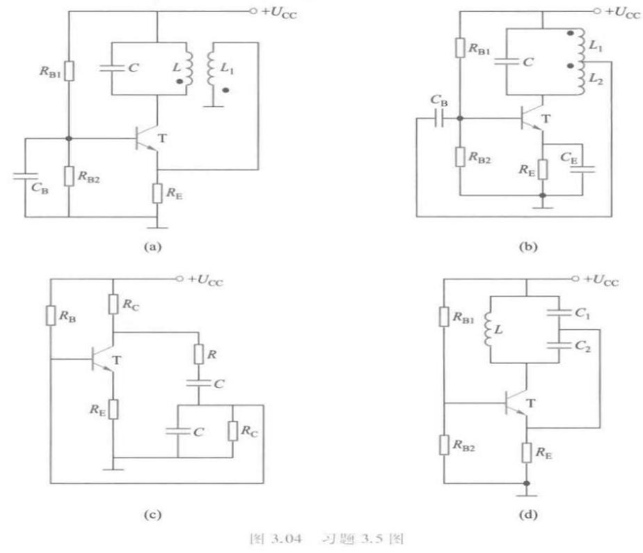

# 2026-11-23作业

## 1. 依赖

判断正弦波振荡电路能否起振，核心是检查**直流偏置是否正常**以及**起振条件（相位平衡 $\varphi_A + \varphi_F = 2n\pi$ 与幅度条件 $|AF| > 1$）**是否同时成立。对具体电路可按下列机械步骤逐项核查：

| 核查项目 | 机械步骤（照做） | 判据与依据 |
| :--- | :--- | :--- |
| **1. 直流偏置与组态识别** | ① 沿直流路径检查 $R_{B1}$、$R_{B2}$、$R_E$ 等偏置元件是否被电感或导线直流短路；② 看基极与发射极对地有无旁路电容 $C_B$、$C_E$，或经偏置电阻接交流地，结合输入／输出端定出共基／共射组态 | 三极管须先能稳定工作在放大区；交流通路里 B 为交流地则是共基（同相），E 为交流地则是共射（反相） |
| **2. 瞬时极性法判反馈极性** | ① 设放大级交流输入端电位瞬时升高（记为 `+`）；② 按组态推出集电极 C 电位极性（共基同相为 `+`，共射反相为 `−`）；③ 依变压器同名端或电容／电感分压，推出反馈网络输出端极性；④ 将反馈极性与原假设极性对比 | 反馈信号增强净输入（同向变化）⇒ **正反馈**（满足 $\varphi_A+\varphi_F=2n\pi$）；削弱净输入（反向变化）⇒ **负反馈**（不能起振），见 [正反馈与负反馈](../课堂笔记/11-18-差分与功率放大电路.md#正反馈与负反馈) |
| **3. LC 三点式「射同余异」复核** | ① 画出交流通路（$+U_{CC}$ 与旁路电容视作交流地）；② 分别列出 B-E、C-E、B-C 之间的电抗性质（感性 $X>0$ 或容性 $X<0$）；③ 核对 $X_{be}$ 与 $X_{ce}$ 是否同性质、$X_{bc}$ 是否异性质 | 只有「射同余异」（$X_{be}$、$X_{ce}$ 同性质，$X_{bc}$ 异性质）才满足正反馈相位条件 |
| **4. RC 网络相移核对** | ① 确定基本放大级相移 $\varphi_A$（单级共射为 $180^\circ$）；② 确定 RC 选频网络相移范围 $\varphi_F$（RC 串并联网络在 $(-\,90^\circ,+90^\circ)$ 内，选频点 $\omega_0$ 处为 $0^\circ$）；③ 检查 $\varphi_A+\varphi_F$ 能否达到 $0^\circ / 360^\circ$ | 若总相移始终达不到 $2n\pi$，则相位平衡条件不成立，不能起振 |
| **5. 幅度起振条件 $\lvert AF\rvert>1$** | 相位条件成立后，在 [三个环节的三个式子](../课堂笔记/11-18-差分与功率放大电路.md#三个环节的三个式子) 给出的 $A$、$F$ 定义基础上，按本页起振条件核查环路增益 $\lvert AF\rvert$（尤其注意无 $C_B$ 时 $R_B$ 会拉低等效跨导） | 正反馈只是必要条件；只有同时满足 $\lvert AF\rvert > 1$（如 $R_B$ 不致过大）电路才能起振 |

> **怎么用**：四幅电路各设一组「提示 → 完整解答 → 复盘」折叠块，**默认收起**——先按上表自己推一遍极性与组态，再逐层展开核对。

---

## 2. 习题 3.5

**题面**（逐字）：

> 3.5 试判断如图 3.04 所示各电路能否产生振荡。

<figure class="fig"><figcaption>图 3.04　习题 3.5 图（(a) 变压器耦合、(b) 抽头电感、(c) RC 串并联、(d) 电容三点式）</figcaption></figure>

**图 3.04 四幅子图接线转写**（按原图逐线核对）：

| 元件／连接 | (a) 变压器耦合 | (b) 抽头电感 | (c) RC 串并联 | (d) 电容三点式 |
| :--- | :--- | :--- | :--- | :--- |
| **放大管与偏置** | NPN 管 `T`；$R_{B1}$ 接 $+U_{CC}$，$R_{B2}$ 接地，$R_E$ 接地 | NPN 管 `T`；$R_{B1}$ 接 $+U_{CC}$，$R_{B2}$ 接地，$R_E$ 接地 | NPN 管 `T`；$R_B$ 接 $+U_{CC}$ 至 B，$R_C$ 接 $+U_{CC}$ 至 C，$R_E$ 接地 | NPN 管 `T`；$R_{B1}$ 接 $+U_{CC}$，$R_{B2}$ 接地，$R_E$ 接地 |
| **旁路电容（定组态）** | B 端有 **$C_B$** 接地（E 端无 $C_E$）⇒ **共基极** | E 端有 **$C_E$** 并联 $R_E$ 接地（B 端无对地旁路电容；图中 $C_B$ 为反馈串联耦合电容）⇒ **共发射极** | B、E 均无旁路电容 ⇒ **共发射极**（输入 B、输出 C） | B 端**无 $C_B$**、E 端无 $C_E$；B 经 $R_B=R_{B1}\parallel R_{B2}$ 接交流地 ⇒ **共基极** |
| **选频／谐振网络** | 集电极侧：$C$ 与原边线圈 $L$ 并联于 $+U_{CC}$ 与 C 之间 | 集电极侧：$C$ 与自耦抽头线圈 $L_1+L_2$ 并联于 $+U_{CC}$ 与 C 之间 | 串联臂 $R$、$C$ 接于 C 与反馈输出节点之间；并联臂 $C$、$R_C$ 接于该节点与地之间 | 集电极侧：$L$ 与串联分压电容 $C_1$、$C_2$ 并联于 $+U_{CC}$ 与 C 之间（$C_1$ 在上、$C_2$ 在下） |
| **同名端／抽头** | $L$ 同名端（黑点）在**下端**（C 端）；副边 $L_1$ 同名端在**下端**（接地端） | $L_1$ 同名端在**上端**（$+U_{CC}$ 端）；$L_2$ 同名端在**上端**（$L_1$-$L_2$ 抽头端） | 无电感线圈 | 无抽头电感；取 $C_1$-$C_2$ 之间抽头 |
| **反馈回线与附加影响** | $L_1$ 下端直接接地，上端直接接发射极 E（将 $R_E$ **直流短路**） | $L_1$-$L_2$ 抽头经耦合电容 $C_B$ 回接基极 B | 串并联网络中点回接基极 B | $C_1$-$C_2$ 抽头直接接发射极 E |

### (a) 变压器耦合电路

:::collapse accordion
- 提示
  先看清两个黑点（同名端）都在哪一端：$L$ 的同名端在下（集电极 C），$L_1$ 的同名端也在下（接地端）。同时注意 B 端有 $C_B$ 交流接地，且 $L_1$ 直接跨在 E 与地之间。

  已收录旁注（不接管步骤）：[正反馈与负反馈](../课堂笔记/11-18-差分与功率放大电路.md#正反馈与负反馈)给出了「净输入被增强或削弱」的极性判据。
- 完整解答
  **第一步：直流通路与交流组态。**
  1. 直流偏置异常：副边线圈 $L_1$ 下端直接接地、上端直接接发射极 E。由于电感线圈对直流近似短路，$L_1$ 将发射极电阻 $R_E$ 直流短路，使发射极静态电位被强行拉至地电位，无法利用 $R_E$ 稳定静态工作点。
  2. 交流组态：基极接有旁路电容 $C_B$ 至地，对交流信号而言 B 处于交流地电位；反馈信号由 $L_1$ 上端送入发射极 E，输出取自集电极 C ⇒ 电路按**共基极组态**工作。

  **第二步：瞬时极性法判反馈极性。**
  假设在某一瞬间，发射极电位 $u_e$ 相对交流地升高，记为 `+`：
  1. 因为基极 B 经 $C_B$ 交流接地（$u_b = 0$），净输入 $u_{be} = u_b - u_e = -u_e$ 减小，导致 $i_b$、$i_c$ 减小；
  2. 集电极电流 $i_c$ 减小，集电极电位 $u_c$ 升高，即 C 端为 `+`（共基极从 E 到 C **同相**）；
  3. 对原边线圈 $L$：上端接 $+U_{CC}$（交流地），下端（同名端）接 C（`+`），因此 $L$ 上同名端（下端）电位高于非同名端（上端），记 $L$ 同名端为 `+`；
  4. 由互感同名端同极性可知，副边线圈 $L_1$ 的同名端（下端）相对其非同名端（上端）也为 `+`；
  5. 因为 $L_1$ 的下端（同名端）直接接地（交流地），所以 $L_1$ 的上端（非同名端）相对地必为 **`−`**；
  6. $L_1$ 上端接回发射极 E，送回的反馈极性为 `−`，与原假设的 $u_e(+)$ **相反**。

  **第三步：结论。**
  反馈信号削弱原输入变化，电路引入的是**交流负反馈**（且 $L_1$ 将 $R_E$ 直流短路），不满足相位平衡条件（$\varphi_A+\varphi_F = 180^\circ \neq 2n\pi$），因此**不能产生振荡**。
- 复盘 :-
  - **最易看错的点**：原边 $L$ 与副边 $L_1$ 表面上都是「下端标点」，看似同名端对齐，但 $L$ 的下端接输出 C、上端接交流地，而 $L_1$ 的下端恰恰接了地、上端接输入 E——相当于一侧「点接信号、非点接地」，另一侧「点接地、非点接信号」，正好反了一次相。
  - **改动方向**：若要把极性翻回正反馈（同时消除 $R_E$ 被直流短路的问题），需将 $L_1$ 同名端改在接 E 的一端，并在反馈支路中串入隔直耦合电容。
:::

### (b) 抽头电感电路

:::collapse accordion
- 提示
  先判组态：E 端有旁路电容 $C_E$ 接地，所以是共发射极。再从 B 加 `+`，推 C 极性，然后看 $L_1$、$L_2$ 抽头是落在 $+U_{CC}$（交流地）和 C 之间的哪一侧；也可以用「射同余异」核对 B、C、E 之间的三个电抗元件。

  已收录旁注（不接管步骤）：[正反馈与负反馈](../课堂笔记/11-18-差分与功率放大电路.md#正反馈与负反馈)给出了净输入增减与正／负反馈的对应关系。
- 完整解答
  **第一步：交流组态识别。**
  发射极接有大容量旁路电容 $C_E$ 并联 $R_E$ 接地，交流信号经 $C_E$ 旁路至地，E 为交流地；信号由抽头经耦合电容 $C_B$ 送入基极 B，输出取自集电极 C ⇒ 电路为**共发射极组态**。

  **第二步：瞬时极性法判反馈极性。**
  假设基极电位 $u_b$ 瞬时升高，记为 `+`：
  1. 在共发射极组态中，B 与 C 反相，$u_b$ 升高使 $i_b$、$i_c$ 增大，集电极电位 $u_c$ 降低，记为 `−`；
  2. 在谐振回路中，电感 $L_1$ 上端接 $+U_{CC}$（交流地，电位为 $0$），$L_2$ 下端接集电极 C（电位为 `−`），$L_1$ 与 $L_2$ 同向绕制（同名端均在各绕组上端）；
  3. 因此从上端（交流地 `0`）到下端（集电极 `−`），线圈上各点对交流地的电位逐段降低，$L_1$-$L_2$ 抽头处的交流电位必然为 **`−`**；
  4. 该 `−` 信号经隔直电容 $C_B$ 加回基极 B，与原假设的 $u_b(+)$ **相反** ⇒ 反馈为**负反馈**。

  **第三步：LC 三点式「射同余异」复核。**
  在交流通路中（$+U_{CC}$ 与 E 均为交流地，抽头接 B，$L_2$ 下端接 C）：
  - B 与 E 之间：$X_{be} = X_{L1}$（**感性**）；
  - B 与 C 之间：$X_{bc} = X_{L2}$（**感性**）；
  - C 与 E 之间：$X_{ce} = X_C$（**容性**）。

  可见 $X_{be}$（感性）与 $X_{ce}$（容性）性质**相反**，而 $X_{be}$ 与 $X_{bc}$ 同为感性，不满足「射同余异」原则，与瞬时极性法结论一致。

  **第四步：结论。**
  电路引入的是**负反馈**，相位条件不成立，**不能产生振荡**。
- 复盘 :-
  - **错误根源**：图 (b) 把电感抽头接到了基极 B，而把交流地（E）接在了 $L_1$ 顶端，相当于把标准电感三点式振荡器中**发射极 E 与基极 B 的接点对调了**，破坏了「射同余异」。
  - **记忆口径**：三点式电路判相位时，先把交流地找准（哪一极有旁路电容就以哪一极接地），再看接在 E 两旁的电抗是否同性质；把 B 错放在中间抽头必然得到负反馈。
:::

### (c) RC 串并联电路

:::collapse accordion
- 提示
  单级共射放大器本身的相移是 $180^\circ$，而 RC 串并联选频网络的相移范围严格落在 $(-\,90^\circ, +90^\circ)$（在中心频率 $\omega_0$ 处为 $0^\circ$）。把两者的相移范围相加，看能不能达到 $0^\circ$ 或 $360^\circ$。

  已收录旁注（不接管步骤）：[三个环节的三个式子](../课堂笔记/11-18-差分与功率放大电路.md#三个环节的三个式子)说明闭环工作由前向放大与反馈系数共同决定。
- 完整解答
  **第一步：识别放大级与反馈网络。**
  1. 放大级：由单个 NPN 三极管构成的**单级共发射极**放大电路（B 端输入，C 端输出，无旁路电容），在工作频段内输出 $u_c$ 与输入 $u_b$ 反相，即基本放大电路相移为
     $$\varphi_A = 180^\circ$$
  2. 反馈网络：由串联支路（$R$ 串 $C$）与并联支路（$C$ 并 $R_C$）组成的 **RC 串并联选频网络**，从集电极 C 取电压信号送回基极 B。

  **第二步：核算 RC 串并联网络的相移范围。**
  设串联支路阻抗为 $Z_1 = R + \frac{1}{j\omega C}$，并联支路导纳为 $Y_2 = \frac{1}{R_C} + j\omega C$，则反馈系数为
  $$\dot{F}(j\omega) = \frac{1}{1 + Z_1 Y_2} = \frac{1}{\left(1 + \dfrac{R}{R_C} + 1\right) + j\left(\omega R C - \dfrac{1}{\omega R_C C}\right)}$$
  分母实部 $2 + \frac{R}{R_C} > 0$ 恒成立，因此对于任意有限频率 $0 < \omega < \infty$，RC 串并联网络的相移严格满足：
  $$-\,90^\circ < \varphi_F < +90^\circ$$
  在选频中心角频率 $\omega_0 = \frac{1}{C\sqrt{R R_C}}$ 处，$\varphi_F = 0^\circ$（若进一步计入基极输入电阻 $R_i$ 与 $R_C$ 并联，等效并联电阻 $R_p = R_C \parallel R_i > 0$，分母实部 $2 + \frac{R}{R_p} > 0$ 依然恒成立，相移范围仍严格在 $(-\,90^\circ,+90^\circ)$ 内）。

  **第三步：检验环路相位平衡条件。**
  环路总相移为
  $$\varphi_A + \varphi_F \in (180^\circ - 90^\circ,\; 180^\circ + 90^\circ) = (90^\circ,\; 270^\circ)$$
  该区间不包含 $0^\circ$ 或 $360^\circ$（$2n\pi$）；特别地在 $\omega = \omega_0$（$\varphi_F = 0^\circ$）时，总相移为 $180^\circ$，反馈回到 B 端为负反馈。

  **第四步：结论。**
  相位平衡条件 $\varphi_A + \varphi_F = 2n\pi$ 无法满足，**不能产生振荡**。
- 复盘 :-
  - **为什么配不起来**：RC 串并联网络（文氏电桥）在谐振点是 **$0^\circ$ 相移**，要求与之配合的放大器必须是**同相放大器**（$0^\circ$ 相移，例如同相比例运放或两级共射放大）；若强行配单级共射（$180^\circ$），只会在选频点得到最强的负反馈。
  - **与 RC 移相网络区分**：若要把单级共射（$180^\circ$）与 RC 网络配成振荡器，反馈网络必须用能产生 $180^\circ$ 相移的**三节 RC 移相网络**，而不是 RC 串并联网络。
:::

### (d) 电容三点式电路

:::collapse accordion
- 提示
  先用「射同余异」或瞬时极性法检查相位：反馈从 $C_1$-$C_2$ 抽头接回 E，输出取自 C。**接着务必检查基极 B**——它不像 (a) 那样接了旁路电容 $C_B$，而是经 $R_{B1}\parallel R_{B2}$ 接交流地，再看这对等效跨导和起振幅度条件有什么影响。

  已收录旁注（不接管步骤）：[三个环节的三个式子](../课堂笔记/11-18-差分与功率放大电路.md#三个环节的三个式子)定义了前向放大 $A$ 与反馈系数 $F$ 的闭环分解关系（本页据此进一步核查环路增益 $|AF|>1$）。
- 完整解答
  **第一步：交流组态与接线核对。**
  - 集电极 C 接 $L$ 下端与 $C_2$ 下端；$L$ 上端与 $C_1$ 上端接 $+U_{CC}$（交流地）；$C_1$-$C_2$ 中间抽头直接接回发射极 E（无 $C_E$），电路为**共基极组态**电容三点式结构。
  - **关键接线特征**：基极 B 通过 $R_{B1}$ 接 $+U_{CC}$、$R_{B2}$ 接地，**基极无旁路电容 $C_B$**，因此基极并非直接交流接地，而是通过分压电阻并联值 $R_B = R_{B1} \parallel R_{B2}$ 接至交流地。

  **第二步：相位条件核查（正反馈）。**
  1. **瞬时极性法**：假设发射极电位 $u_e$ 相对交流地瞬时升高（`+`）。尽管基极存在未旁路电阻 $R_B$，由 $\Delta u_b = -\Delta i_b R_B$ 与 $\Delta u_{be} = \Delta i_b r_{be}$ 可得
     $$\Delta u_e = \Delta u_b - \Delta u_{be} = -\Delta i_b\,(R_B + r_{be})$$
     故当 $\Delta u_e > 0$ 时必有 $\Delta i_b < 0$，从而 $\Delta u_b = \frac{R_B}{R_B+r_{be}}\Delta u_e < \Delta u_e$，净输入 $\Delta u_{be} = -\frac{r_{be}}{R_B+r_{be}}\Delta u_e < 0$ 仍严格减小，导致 $i_c$ 减小、集电极电位 $u_c$ 升高（`+`）。在电容分压支路 $C_1$-$C_2$ 上，上端为交流地（`0`）、下端为 $u_c(+)$，故 $C_1$-$C_2$ 抽头对交流地电位必为 **`+`**，反馈回 E 与原假设 $u_e(+)$ **同相** ⇒ 相位满足**正反馈**。
  2. **「射同余异」复核**：$C_1\parallel R_E$ 与 $L$ 上端均接于交流地，B 经纯电阻 $R_B$ 接交流地（纯电阻不改变支路电抗的容／感性符号）。交流通路中三端之间的电抗性质为：
     - B 与 E 之间：$X_{be} = X_{C1}$（**容性**，与 $R_E$ 并联）；
     - C 与 E 之间：$X_{ce} = X_{C2}$（**容性**）；
     - B 与 C 之间：$X_{bc} = X_L$（**感性**）。
     $X_{be}$ 与 $X_{ce}$ 同为容性，$X_{bc}$ 为感性，满足「射同余异」原则，相位平衡条件成立。

  **第三步：无旁路电容 $C_B$ 对幅度条件的影响。**
  由于基极**没有接旁路电容 $C_B$**，$R_B = R_{B1} \parallel R_{B2}$ 串入了基极-发射极交流输入回路。对共基极交流输入信号 $u_e$（相对交流地）有：
  $$\Delta u_e \approx -\Delta i_b\,(R_B + r_{be}), \qquad \Delta i_c = \beta\,\Delta i_b \approx -\frac{\beta}{R_B + r_{be}}\,\Delta u_e$$
  与有 $C_B$ 旁路（等效跨导 $g_m = \frac{\beta}{r_{be}}$）相比，无 $C_B$ 时电路的等效跨导降至
  $$g_m' = \frac{\beta}{R_B + r_{be}}$$
  从而使开环电压增益 $A$ 与环路增益 $|AF|$ 相应下降。

  **第四步：结论。**
  该电路相位条件严格满足正反馈；在**基极无旁路电容 $C_B$** 的前提下，只要 $R_B = R_{B1}\parallel R_{B2}$ 不致过大，使得电路仍能满足起振幅度条件 $|AF| > 1$（且 $R_E$、$R_B$ 分流后的回路品质因数足够），该电路**能产生振荡**（若 $R_B$ 过大导致 $|AF| < 1$，则不能起振）。
- 复盘 :-
  - **为什么必须点出无 $C_B$**：很多解题直接套「电容三点式 + 射同余异 ⇒ 能振荡」，漏掉了对比 (a) 和 (d) 基极处的差异——(a) 画了 $C_B$ 而 (d) 没画 $C_B$。无 $C_B$ 不改相位极性（仍为正反馈），但会通过 $g_m' = \frac{\beta}{R_B+r_{be}}$ 直接压缩环路增益 $|AF|$。
  - **工程补充**：实际设计共基极电容三点式振荡器时，通常会在基极与地之间并联一只高频旁路电容 $C_B$，把基极真正接到交流地，从而将等效跨导恢复为 $\frac{\beta}{r_{be}}$，增大环路增益裕量，确保稳定起振。
:::

---

**四幅电路结论汇总**：

| 子图 | 电路类型与交流组态 | 相位／偏置判据结果 | 能否产生振荡 | 关键原因 |
| :--- | :--- | :--- | :--- | :--- |
| **(a)** | 变压器耦合（共基极） | 负反馈（且 $R_E$ 被 $L_1$ 直流短路） | **不能** | $L$ 同名端在 C 端、$L_1$ 同名端在接地端，反馈回 E 的信号与原输入反相 |
| **(b)** | 抽头电感（共发射极） | 负反馈（不满足「射同余异」） | **不能** | 抽头接回 B、E 接 $L_1$ 顶端，$X_{be}$ 与 $X_{ce}$ 异性质，瞬时极性得负反馈 |
| **(c)** | RC 串并联（单级共射） | 相位平衡不成立 | **不能** | 单级共射 $180^\circ$ 配 RC 串并联（相移在 $(-90^\circ,+90^\circ)$、$\omega_0$ 处 $0^\circ$），总相移达不到 $0^\circ/360^\circ$ |
| **(d)** | 电容三点式（共基极，无 $C_B$） | 正反馈（满足「射同余异」） | **能（当 $\lvert AF\rvert>1$ 时）** | 相位满足正反馈；因基极无 $C_B$，等效跨导降为 $\frac{\beta}{R_B+r_{be}}$，在 $R_B$ 不致过大且满足 $\lvert AF\rvert>1$ 时能起振 |

---

## 完成边界

- [issue #44](https://github.com/ArchivalEra/S26-1_202609/issues/44)
